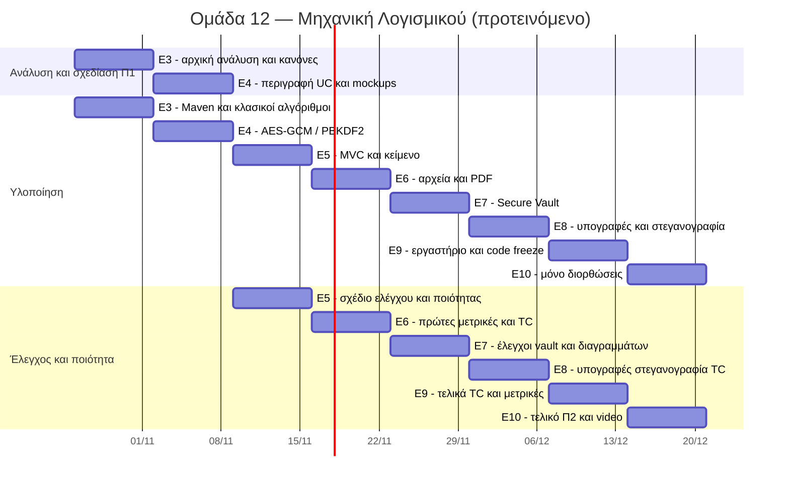

# 1.2 — Διάγραμμα Gantt (Ε3–Ε10)

**Υπεύθυνος:** Νίκος Πετράκης · **Έκδοση:** 2/11/2026 · **Κατάσταση:** Προτεινόμενο χρονοδιάγραμμα, όχι επίσημες προθεσμίες.

Το αρχείο [programma.csv](programma.csv) περιέχει αναλυτικές εργασίες, υπεύθυνους, ημερομηνίες, στάδια, παραδοτέα και κατάσταση. Μπορεί να ανοίξει με Excel (διαχωριστικό `;`), να εμπλουτιστεί και να αποτελέσει τη βάση για τελικό γράφημα Gantt. Η απεικόνιση που ακολουθεί περιγράφει τις εβδομαδιαίες φάσεις, όχι ακριβείς ώρες εργασίας.

## Ρόλοι

- **Νίκος (PM & Ποιότητα):** κανόνες repo, 1.1–1.2, σύνθεση Π1, μετρικές 2.5 και τελικό Π2.
- **Απόστολος (Αναλυτής & Ελεγκτής):** απαιτήσεις, UC, tests, 5 επίσημα TC, screenshots, video.
- **Λεωνίδας (Σχεδιαστής):** UI, mockups, FXML/CSS, class diagram, sequence diagrams.
- **Ηλίας (Προγραμματιστής):** Java/Maven και σταδιακή λειτουργική υλοποίηση.

## Εξαρτήσεις και ορόσημα

**Π1 — προτεινόμενη λήξη 8/11/2026:** 1.1–1.5 και έλεγχος συνέπειας. **Π2 — προτεινόμενη λήξη 20/12/2026:** 2.1–2.7 και παρουσίαση. **Code freeze — προτεινόμενο 13/12/2026.** Οι ημερομηνίες αλλάζουν αν ανακοινωθούν διαφορετικές επίσημες προθεσμίες.

**Εκκρεμεί:** επιβεβαίωση μοντέλου ανάπτυξης από την ομάδα, ενσωμάτωση των 1.3–1.5 του Απόστολου, έλεγχος mockups από τον Λεωνίδα και παραγωγή εξαγώγιμου τελικού PNG ή αρχείου GanttProject / Excel πριν από το τελικό Π1.
