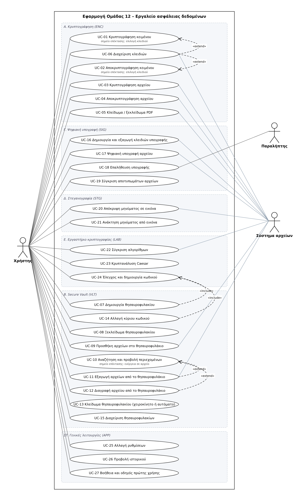

# 1.4 Διάγραμμα περιπτώσεων χρήσης — αιτιολόγηση

Ομάδα 12 · Υπεύθυνος: Απόστολος Δαγκλής (Αναλυτής & Ελεγκτής)

Πηγαίο αρχείο: [`uc-diagram.drawio`](uc-diagram.drawio) (άνοιγμα με draw.io / diagrams.net). Οι UC, οι actors και
οι προτεραιότητες είναι αυτές του [1.3](../1.3-apaitiseis.md)· η κάθε UC περιγράφεται στο [1.5](../1.5-uc-specs/).

## Τι δείχνει

- **27 UC** μέσα στο όριο του συστήματος. Τα γκρι πλαίσια (Α–ΣΤ) είναι μόνο οπτική ομαδοποίηση ανά ενότητα, όχι
  στοιχεία UML.
- **Χρήστης** (κύριος actor): συνδέεται με όλες τις UC.
- **Σύστημα αρχείων** (δευτερεύον): οι 10 UC που διαβάζουν ή γράφουν αρχεία του χρήστη
  (UC-03, 04, 05, 06, 09, 11, 16, 17, 20, 22).
- **Παραλήπτης** (δευτερεύον): UC-18, όποιος επαληθεύει υπογραφή με το δημόσιο κλειδί.

## Σχέσεις — μία γραμμή ανά σχέση

Φορά βελών: το «include» ξεκινά από τη **βασική** UC και δείχνει την **περιεχόμενη**· το «extend» ξεκινά από την
**επέκταση** και δείχνει τη **βασική**.

| # | Σχέση | Αιτιολόγηση |
|---|---|---|
| 1 | UC-06 Διαχείριση κλειδιών «extend» UC-01 Κρυπτογράφηση κειμένου | Προαιρετική: μόνο αν ο χρήστης διαλέξει τυχαίο κλειδί αντί για κωδικό (σημείο επέκτασης «επιλογή κλειδιού», ροή 3a1)· η UC-01 ολοκληρώνεται και χωρίς αυτή. |
| 2 | UC-06 Διαχείριση κλειδιών «extend» UC-02 Αποκρυπτογράφηση κειμένου | Ίδιο σημείο επέκτασης: φόρτωση του κλειδιού από αρχείο μόνο όταν το κείμενο κρυπτογραφήθηκε με κλειδί. |
| 3 | UC-11 Εξαγωγή «extend» UC-10 Αναζήτηση και προβολή | Ο χρήστης βλέπει τα περιεχόμενα και *μπορεί* να εξαγάγει το επιλεγμένο αρχείο (σημείο επέκτασης «ενέργεια σε αρχείο»). |
| 4 | UC-12 Διαγραφή «extend» UC-10 Αναζήτηση και προβολή | Το ίδιο σημείο: η διαγραφή είναι προαιρετική ενέργεια πάνω σε αρχείο που επιλέχθηκε στη λίστα. |
| 5 | UC-07 Δημιουργία θησαυροφυλακίου «include» UC-24 Έλεγχος και δημιουργία κωδικού | Ο έλεγχος ισχύος εκτελείται **πάντα** στη δημιουργία (VLT-01) και είναι η ίδια συμπεριφορά με το LAB-07· γράφεται μία φορά. |
| 6 | UC-14 Αλλαγή κύριου κωδικού «include» UC-24 Έλεγχος και δημιουργία κωδικού | Ο νέος κύριος κωδικός περνά υποχρεωτικά τον ίδιο έλεγχο ισχύος με τη δημιουργία (ελάχιστο: απόφαση #12). |

## Τι δεν σχεδιάστηκε ως σχέση (και γιατί)

- **UC-09…UC-14 ← UC-08 Ξεκλείδωμα:** το ξεκλείδωμα είναι *προϋπόθεση* (γράφεται στις προϋποθέσεις του 1.5), όχι
  κοινό κομμάτι ροής· ως «include» θα έλεγε ότι κάθε προσθήκη αρχείου ξαναζητά κωδικό, που δεν ισχύει.
- **UC-17/UC-18 ← UC-16:** τα κλειδιά πρέπει να υπάρχουν από πριν (προϋπόθεση), δεν δημιουργούνται μέσα στην υπογραφή.
- **UC-27 Βοήθεια:** διαθέσιμη από κάθε οθόνη· 26 βέλη «extend» θα έκαναν το διάγραμμα δυσανάγνωστο χωρίς να λένε
  κάτι παραπάνω.
- **APP-01…APP-05** (πλοήγηση, μηνύματα, επιβεβαιώσεις) ισχύουν μέσα σε όλες τις UC και δεν είναι ξεχωριστές UC (1.3).
- **Μαζική κρυπτογράφηση (ENC-11)** είναι εναλλακτική ροή 2a1 της UC-03, όχι χωριστή UC, όπως ορίζει το 1.3.
